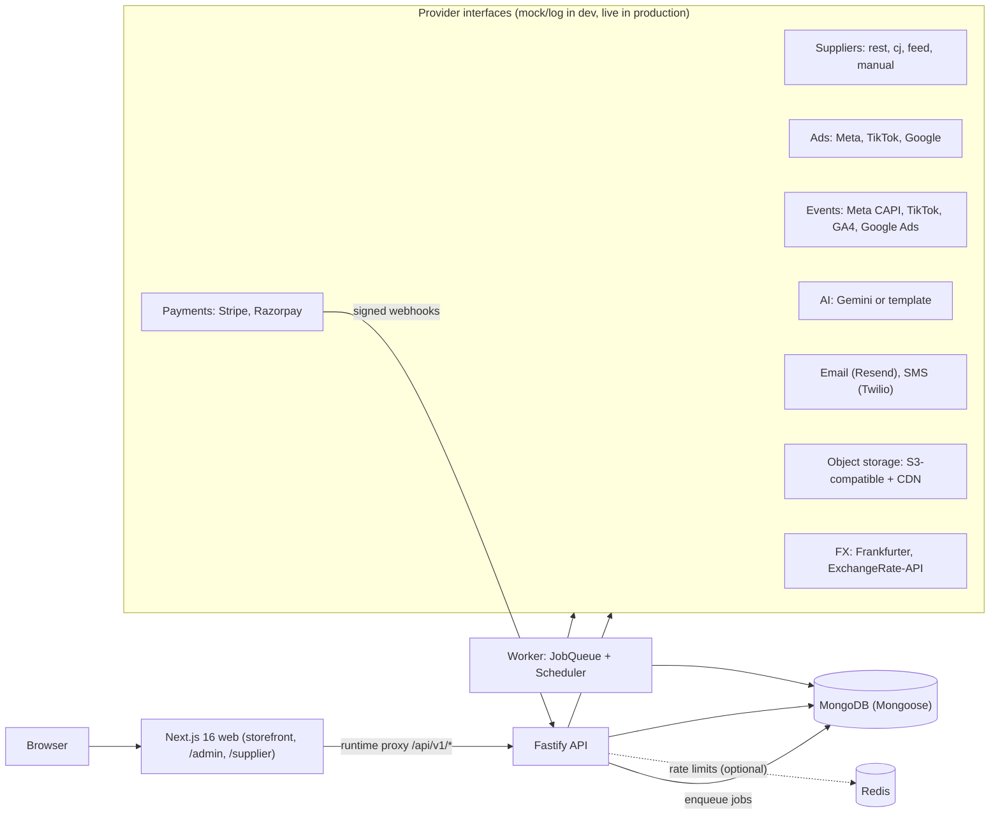

# ORVIA AI

ORVIA is a trust-first commerce platform for a multi-country, supplier-fulfilled store (US, Canada, India; extensible). ORVIA owns the customer experience, trust information, after-sales and repeat purchase. Suppliers hold the stock and ship. ORVIA never owns inventory.

> **Read this first: production readiness.** Everything here builds and its DB-less unit tests pass, but **nothing has been verified against a live Stripe, Razorpay, CJ Dropshipping, Meta, TikTok, Google (Ads/GA4), Gemini, email or SMS account.** Every integration runs against in-repo mock or fake providers, which production refuses to start with. The Mongo-backed integration tests and the Playwright browser tests were **written but not executed in the build session** (the MongoDB binary could not be downloaded there); they are designed to run in CI. Do not accept real customer payments until the checklist in [docs/ORVIA_LIMITATIONS_AND_NEXT_STEPS.md](docs/ORVIA_LIMITATIONS_AND_NEXT_STEPS.md#before-accepting-real-customer-payments) is complete. The full status table is in [Production readiness status](#production-readiness-status).

## Contents

[Overview](#orvia-ai-overview) · [Vision](#product-vision) · [What is different](#what-makes-orvia-different) · [Capabilities](#consumer-capabilities) · [Architecture](#technical-architecture) · [Install and run](#installation) · [Testing](#testing) · [Deploy](#deployment-instructions) · [Integrations](#integration-setup) · [Readiness](#production-readiness-status) · [Roadmap](#roadmap) · [Docs index](#documentation)

## ORVIA AI overview

One repository containing:

| Part | Where | What it is |
|---|---|---|
| Storefront | `apps/web` (Next.js 16, React 19) | Catalogue, ORVIA Find, compare, product page with passport and purchase confidence, cart, checkout, order tracking, account (returns, aftercare, Price Guard, LifeGraph, memory, privacy), creator pages and portal |
| Admin console | `apps/web` under `/admin` | 33 sections: orders, products, suppliers, supplier network, TrustGraph, Delivery Rescue, Customer 360, returns and chargebacks, finance, creators and loyalty, tracking and campaigns, AI agents, launch readiness, audit and more |
| Supplier portal | `apps/web` under `/supplier` | Separate sign-in for users with role `SUPPLIER`: orders to ship, documents, verification, statements, disputes |
| API | `apps/api` (Fastify 5, zod, OpenAPI) | All business endpoints under `/api/v1` |
| Worker | `apps/worker` | Durable job queue consumer and scheduler (41 default schedules) |
| Domain engine | `packages/core` | Orders, pricing, fraud, TrustGraph, rescue, after-sales, finance, find, agents and the rest |
| Adapters | `packages/{suppliers,payments,ads,ai,notifications,shipping}` | Provider interfaces with mock/log and live implementations |
| Design system | `packages/ui` | Tokens, light and dark themes, accessible components |

Money is integer minor units. Deterministic code decides money, payment status, order transitions, tax, authorization, refund eligibility and settlement. AI may suggest, explain and word answers; it never authorizes a financial transaction or a permission change (see [docs/ORVIA_AI_AGENTS.md](docs/ORVIA_AI_AGENTS.md)).

## Product vision

Shoppers should be able to buy from a supplier-fulfilled store and still know what they are getting, when it will arrive, what happens if it does not, and whether the price is fair. ORVIA tries to earn that by showing only facts it holds (with their source and freshness), saying "insufficient data" instead of inventing a score, recovering failing deliveries on the shopper's behalf, and keeping the customer relationship after the parcel arrives. Details, principles, category focus and the product acceptance checklist: [docs/ORVIA_PRODUCT_VISION.md](docs/ORVIA_PRODUCT_VISION.md).

## What makes ORVIA different

These are design choices and combinations of capabilities, not claims about what other retailers lack.

- **Provenance on every fact.** Product, supplier and delivery facts carry one of `verified`, `supplier_provided`, `customer_reported`, `ai_suggested`. Only a person can record `verified` evidence; AI text in claim positions (safety, certification, compliance) is stripped.
- **Statistics that admit uncertainty.** Supplier reliability uses a Beta-Binomial posterior with prior strength 10; below 5 resolved shipments the score is `null` and the UI says "Not enough delivery history yet". Delivery bands widen with small samples.
- **Failure handling is part of the product.** Delivery Rescue classifies a failing line, plans options with computed cost impact, asks the shopper for consent when terms change, and executes idempotently with an immutable timeline.
- **Money is deterministic and auditable.** Append-only double-entry ledger with FX snapshots; every figure labelled `actual`, `mixed`, `estimated` or `unavailable`.
- **Supplier evidence, not API reachability.** A supplier is routable in production only when approved and production-ready after an evidence checklist.
- **Governed AI.** Eleven agents read through typed tools, with budgets, a kill switch, audit, grounding checks and confirmation-gated writes.
- **Consent-first customer data.** LifeGraph and Commerce Memory are opt-in, inspectable, exportable and deletable; server-side tracking sends nothing without consent.

## Consumer capabilities

- Browse, typo-tolerant search, categories and "shop by need" pages (`/needs/[slug]`).
- **ORVIA Find** (`/find`): natural-language search with an understanding panel and "why matched", gift/budget presets, alternatives for unavailable products, saved searches. Image search needs a Gemini key.
- **Compare** (`/compare`, 2 to 4 products).
- Product page: Product Passport, Purchase Confidence, Price Guard controls, price history, better-offer notice, creator-attribution capture.
- Cart, checkout (server-side pricing, idempotent), guest order lookup, order tracking, recovery page when a delivery fails (`/orders/[orderNumber]/recovery`).
- Account: orders, wishlist, referrals, loyalty, returns wizard with photo evidence, aftercare, price alerts, saved searches, preferences, memory, privacy centre (consents, export, deletion request).
- Shopping Assistant widget (deterministic intents; model wording needs a Gemini key).

## Customer relationship capabilities

- **Customer 360** (staff, `/admin/customer-360`): masked search, aggregated profile, consent history, timeline, notes; every view audited; PII reveal needs write permission plus a reason.
- **LifeGraph**: opt-in interests and life-context nodes with an allow-list/deny-list guard; the customer can view, edit, export and delete it.
- **Commerce Memory**: explicit-opt-in saved items with retention and a master switch.
- **Product Companion** (`/account/products/[orderItemId]`) and **Aftercare** hub (`/account/aftercare`): per-product help built only from stored data; missing facts are stated as missing.
- **Customer Advocate**: policy-bounded resolution recommendation for a problem order, executed through the rescue and returns engines.
- Details: [docs/ORVIA_CUSTOMER_EXPERIENCE.md](docs/ORVIA_CUSTOMER_EXPERIENCE.md), [docs/ORVIA_AFTERSALES.md](docs/ORVIA_AFTERSALES.md).

## Supplier ecosystem

- Adapters: `rest` (configurable mapping), `cj` (CJ Dropshipping), `feed` (read-only CSV/JSON catalogue, price, stock), `manual` (operator-entered offers and orders). Named vendors without an adapter (AliExpress, DSers, Spocket, Zendrop, Syncee, DropCommerce, Wholesale2B, Modalyst, Printful, Printify) are planned.
- Onboarding state machine (`invited` to `approved`, plus `suspended`) with evidence-based verification, document expiry, SLA targets from real shipments, disputes, return authorization and payables reconciliation (record-only).
- Catalogue ingestion with matching (GTIN check digit, brand, measurements) and a human matching queue; quote comparison with freshness labels.
- Supplier portal with tenant isolation (a foreign id returns 404). See [docs/ORVIA_SUPPLIER_NETWORK.md](docs/ORVIA_SUPPLIER_NETWORK.md).

## Product Intelligence (Digital Product Passport)

`GET /api/v1/products/:slug/passport?country=`: identity, listing summary (labelled `ai_suggested`, claim-stripped), specifications and materials with provenance, images with source and usage-rights status, certificates and documents (verified only if evidence is verified and unexpired), destination restrictions, stock freshness (fresh up to 24 h, aging up to 96 h, then stale), price history where recorded, and promised-versus-actual delivery. Facts ORVIA does not hold are shown as unknown. See [docs/ORVIA_TRUSTGRAPH.md](docs/ORVIA_TRUSTGRAPH.md).

## TrustGraph

Product, manufacturer (only if evidenced), supplier, order, shipment, delivery, feedback, return and refund are read from existing collections. Outputs: supplier reliability (10 weighted components, per-destination slices shrunk toward the global record), product risk (0 to 100, `unknown` when insufficient), snapshots with inputs and model version for audit, a Fair Deal ranking of offers for the same product (substitution needs explicit customer consent), and Purchase Confidence (information completeness, delivery band, return window, total delivered price estimate). Admin: `/admin/trust`.

## Delivery Rescue

Job `rescue_scan` (every 10 minutes) detects supplier cancellation, stock shortage, acceptance failure, failed delivery, suspected loss, carrier exception, invalid tracking, delay and unusual patterns; plans options (continue, reorder with another supplier, equivalent replacement, partial or full refund, human); applies a stored authorization policy (automatic execution is **off** by default); requires signed, expiring customer consent for any material change; and executes with idempotency keys and a duplicate-order guard. Admin: `/admin/rescue`. See [docs/ORVIA_DELIVERY_RESCUE.md](docs/ORVIA_DELIVERY_RESCUE.md).

## Customer 360 and LifeGraph

See [Customer relationship capabilities](#customer-relationship-capabilities). Consent kinds, retention and deletion handling are described in [docs/ORVIA_CUSTOMER_EXPERIENCE.md](docs/ORVIA_CUSTOMER_EXPERIENCE.md).

## Price Guard

Daily per-country price snapshots (written only on change), history shown only over the span actually observed, and alerts for price drop, target price, back in stock and a better verified offer (same category, no conflicting key attribute, at least 3 reviews on both, rating within 0.3, at least 5 percent cheaper delivered). Alerts email only verified accounts, only the creator of the alert, and each condition fires once. Compare-at prices are never manufactured. See [docs/ORVIA_FIND.md](docs/ORVIA_FIND.md).

## Product Companion

Per purchased item: stored product facts, order and shipment state, return eligibility, warranty only where data exists, and next-step links. See [docs/ORVIA_CUSTOMER_EXPERIENCE.md](docs/ORVIA_CUSTOMER_EXPERIENCE.md).

## Commerce finance

- Append-only, idempotent double-entry ledger (`finance_ledger`) with per-entry FX snapshot; sync job `ledger_sync` every 10 minutes; daily read-only reconciliation.
- Definitions kept apart: GMV, net sales, gross profit, contribution, estimated net profit.
- FX provider interface (`frankfurter` default in production, `exchangerate_api`, `static` for dev/test only); production refuses to price orders from expired rates unless an admin sets an audited override.
- Cash-flow forecast and a scenario model for a stated revenue target; the target is an input and the model can answer `not_reachable`.
- Admin: `/admin/finance`. See [docs/ORVIA_FINANCIAL_MODEL.md](docs/ORVIA_FINANCIAL_MODEL.md) and [docs/ORVIA_12_MONTH_GROWTH_STRATEGY.md](docs/ORVIA_12_MONTH_GROWTH_STRATEGY.md).

## Marketing and creator ecosystem

- **Creators**: application, handle rules, collections of real sellable products, public pages with paid-partnership disclosure, share links, first-party attribution, commissions with hold and clawback, payouts (execution is manual), fraud controls, loyalty points and tiers, referral hardening. Admin: `/admin/creators`. See [docs/ORVIA_CREATORS_AND_LOYALTY.md](docs/ORVIA_CREATORS_AND_LOYALTY.md).
- **Tracking and campaigns** (`/admin/campaigns`): consent-gated server-side events to Meta Conversions API, TikTok Events API, GA4 Measurement Protocol and Google Ads conversions via an outbox with retry and dead-letter; browser pixels after consent; segments, email campaigns, experiments, attribution and product feeds (Google Merchant RSS, Meta CSV). See [docs/ORVIA_MARKETING_AND_TRACKING.md](docs/ORVIA_MARKETING_AND_TRACKING.md).
- Paid ad activation stays proposal-only: launches always require a human, with per-campaign, daily and monthly caps ([docs/ADS.md](docs/ADS.md)).

## Technical architecture



Key properties: the queue lives in MongoDB (at-least-once, lease-based locks, dedupe keys, dead-letter), so restoring Mongo restores pending work; the scheduler claims each time slot atomically, so running more than one worker is safe; Redis is optional and only affects rate limiting. More: [docs/ARCHITECTURE.md](docs/ARCHITECTURE.md).

## Repository structure

```
apps/api         Fastify API (routes/, http.ts route helper, plugins.ts)
apps/worker      queue consumer + scheduler + health/metrics endpoint
apps/web         Next.js: src/app/(store), src/app/admin, src/app/supplier, src/components
packages/types   enums, zod schemas, countries, money
packages/config  env schema + production guard, logger, metrics, fetch helpers
packages/database  Mongoose models (models.ts + models.<area>.ts)
packages/auth    scrypt, JWT, RBAC permission matrix, AES-256-GCM
packages/core    domain/<area>/ (trust, rescue, customer360, find, finance, creators, events,
                 suppliernet, aftersales, agents + orders, catalog, pricing...), jobs/, infra/
packages/{suppliers,payments,ads,ai,notifications,shipping,analytics,ui}
infra/docker     multi-stage Dockerfile (targets api | worker | web | seed)
infra/terraform  AWS reference (VPC, ALB, ECS Fargate, ElastiCache, S3, Secrets Manager, CloudWatch)
tests/           unit (DB-less), integration (Mongo-backed), e2e (Playwright), helpers
scripts/         dev, seed, migrate, e2e, production-check, boot-check, verify-staging, load, perf
docs/            architecture, per-area ORVIA_*.md, deployment, security, limitations
```

## Technology stack

TypeScript (npm workspaces), Node.js 20.11 or newer (22 in CI and the Dockerfile), Fastify 5, zod 4, Mongoose 8 on MongoDB (7 in CI and compose), optional Redis 7 (ioredis), Next.js 16 with React 19 and Tailwind 4, sharp for image processing, Stripe SDK, Razorpay REST, Gemini REST, Resend and Twilio REST, pino logs, in-process Prometheus-format metrics, vitest, Playwright, Docker, Terraform (AWS).

## Installation

Requirements: Node.js >= 20.11 and npm 10. Docker is optional.

```bash
npm ci
```

## Environment configuration

Variables are validated at start-up by `packages/config`; `.env.example` is the template and `docs/ORVIA_DEPLOYMENT.md` groups every variable. Never commit `.env`.

For local development you can skip `.env` entirely: sensible development defaults exist. If you do copy it, note that `.env.example` leaves `JWT_SECRET` and `ENCRYPTION_KEY` empty (generate with `openssl rand -hex 32`) and sets `GEMINI_API_KEY` to a placeholder string, which the code treats as a configured key; blank it unless you have a real one.

Minimum for production (`APP_ENV=production`; the process refuses to start otherwise): `MONGODB_URI`, `JWT_SECRET` (32+ chars), `ENCRYPTION_KEY` (64 hex), `COOKIE_SECURE=true`, `SUPPLIER_MODE=live`, `PAYMENT_MODE=live`, `ADS_MODE=live`, `NOTIFY_MODE=live`, `OBJECT_STORAGE_PROVIDER=s3` with bucket and an https `CDN_BASE_URL`, no `FX_PROVIDER=static`, `ALLOW_PRIVATE_FETCH=false`, `SEED_ON_START` unset, and if `EVENTS_PROVIDERS` is set then `EVENTS_MODE=live` with credentials.

## Database setup

MongoDB 7 is the only required datastore. In development an embedded `mongod` (mongodb-memory-server, data in `.mongo-data/`) starts automatically if nothing listens on port 27017; this downloads a MongoDB binary on first use and does not work where that download is blocked. Alternatives: `docker compose up -d mongo`, or any MongoDB reachable through `MONGODB_URI`.

## Migrations

There are no data migrations. `npm run migrate` (`scripts/migrate.ts`) creates every collection and declared index and reports stale indexes without dropping them. Production runs with `autoIndex` off, so run it once before first start and after any release that adds indexes. On a database created by the original release, drop the legacy `orderId_1_lineKey_1` Shipment index first ([docs/LIMITATIONS.md](docs/LIMITATIONS.md) #15).

## Local development

```bash
npm run dev      # MongoDB (embedded if needed) + seed demo data + API :4000 + worker :4100 + web :3000
```

| What | Where |
|---|---|
| Storefront | http://localhost:3000 |
| Admin console | http://localhost:3000/admin, `owner@orvia.test` / `Orvia-Demo-2026!` (other staff: `admin@`, `marketing@`, `ops@`, `support@`, `analyst@orvia.test`) |
| API and OpenAPI docs | http://localhost:4000/docs (disabled in production) |

Seed data and these passwords are for development only; the seed script refuses to run in production. A test order: add to cart, check out, "Pay now" (the mock provider delivers a signed webhook through the real verification path); the worker then places the mock supplier order and tracking advances on an accelerated clock (`MOCK_TIME_SCALE`).

### Running frontend, backend and background workers separately

| Process | Command | Notes |
|---|---|---|
| API | `npm run dev:api` | hot reload; set `API_INLINE_WORKER=true` to also process jobs in this process (never in production) |
| Worker | `npm run worker` (or `npm run dev:worker`) | queue consumer, scheduler (`SCHEDULER_ENABLED`), health on `WORKER_PORT` (4100) |
| Web | `npm run dev:web` | needs `API_URL` pointing at the API (default `http://localhost:4000`) |

Built output: `npm run start -w @orvia/api`, `npm run start -w @orvia/worker`, `npm run start -w @orvia/web` (after `npm run build`).

## Commands

| Command | Purpose |
|---|---|
| `npm run dev` | whole stack with hot reload |
| `npm run dev:api` / `dev:worker` / `dev:web` / `worker` | single process |
| `npm run build` | production bundles for api, worker, web |
| `npm test` | all vitest tests (needs MongoDB, see Testing) |
| `npm run test:coverage` | same with coverage floors on `packages/core` (lines 80, branches 70); what CI runs |
| `npm run e2e` | Playwright journeys, desktop and mobile (builds and starts an ephemeral stack) |
| `npm run lint` / `typecheck` / `format:check` | eslint (zero warnings) / tsc in every workspace / prettier |
| `npm run seed` / `migrate` | demo data (dev only) / collections and indexes |
| `npm run boot-check` | builds the API with every route and job handler registered, no database |
| `npm run production-check` | release gate: lint, typecheck, tests, build, config guard, secret scans, E2E |
| `npm run verify:staging` / `certify` | live read-only provider checks against staging / record certification |
| `npm run terraform:check` | static Terraform structure check (not `terraform validate`) |
| `npm run perf` / `load` / `load:jobs` | load tooling ([docs/PERFORMANCE.md](docs/PERFORMANCE.md)); results pending |
| `npm run sbom` | CycloneDX SBOM of production dependencies |
| `make help` | Makefile aliases and Docker targets |

## Testing

| Layer | Where | Needs | Command |
|---|---|---|---|
| DB-less unit tests (23 files in `tests/unit`) | pure logic: scoring, classifiers, refund math, state machines, ledger builders, find engine, hashing, agent framework, contrast | Node only | see below |
| Mongo-backed integration tests (30 files in `tests/integration`) | routes plus domain flows against real Mongoose | MongoDB | `docker run -d -p 27017:27017 mongo:7`, then `TEST_MONGO_URI=mongodb://127.0.0.1:27017/ npm test` (CI sets `TEST_MONGO_URI` to a `mongo:7` service). Without it, `tests/helpers/globalSetup.ts` starts mongodb-memory-server |
| Playwright E2E (6 spec files in `tests/e2e`; 106 entries over the desktop and mobile projects) | browser journeys: purchase to delivery, discovery and compare, customer lifecycle, admin orders, supplier portal, responsive and accessibility basics | MongoDB binary, Chromium | `npx playwright install --with-deps chromium && npm run e2e`. One spec: `npm run e2e -- tests/e2e/customer-lifecycle.spec.ts --project=desktop` |

DB-less run (the repo's own `vitest.config.ts` has a `globalSetup` that starts MongoDB, so use a separate config kept outside the repo or untracked):

```js
// vitest.nodb.config.mjs
export default { root: process.cwd(), test: { include: ['tests/unit/**/*.test.ts'], env: { NODE_ENV: 'test' } } };
```

```bash
npx vitest run --config vitest.nodb.config.mjs
```

What was actually run in the build session ([docs/ORVIA_TEST_REPORT.md](docs/ORVIA_TEST_REPORT.md)): typecheck, lint, 463 DB-less unit tests passed (that report inventories 20 files; `agents-framework`, `agents-logic` and `design-contrast` exist in addition and are not in its total), `npm run build`, `npm run boot-check`, Playwright spec discovery. **Not run:** the Mongo-backed integration tests (about 220 cases), Playwright execution, Docker image builds, Terraform validation, load tests, any live provider. No number is claimed for them.

## Production build

```bash
npm run build          # api and worker (esbuild bundles), web (next build)
npm run boot-check     # no database needed
```

## Docker deployment

`infra/docker/Dockerfile` builds `api`, `worker`, `web` (non-root, health checks) and a dev-only `seed` target. `docker-compose.yml` is the development stack (mock providers, demo data via `docker compose --profile seed run --rm seed`). `docker-compose.prod.yml` runs the three images against external MongoDB and Redis using `.env.production`; put a TLS-terminating proxy in front. CI builds the images (job `docker`); **this build session did not run a Docker build.** Details: [docs/ORVIA_DEPLOYMENT.md](docs/ORVIA_DEPLOYMENT.md).

## Deployment instructions

1. Provision MongoDB (Atlas recommended), object storage and CDN, secrets, and optionally Redis.
2. Build and push images; deploy `api`, `worker` (one is enough), `web`.
3. Run `npm run migrate` once with the API image.
4. Register payment webhooks, set provider credentials in staging first, run `npm run verify:staging`.
5. Work through the rollout checklist in [docs/ORVIA_DEPLOYMENT.md](docs/ORVIA_DEPLOYMENT.md#rollout-checklist) and `/admin/launch-readiness`.

AWS Terraform (`infra/terraform`) is a reference module: CI runs `init -backend=false`, `validate` and `fmt -check`; it has never been planned or applied.

## Integration setup

Nothing below is verified live. Do each in staging with sandbox credentials first.

| Integration | Exact external action | Variables |
|---|---|---|
| Stripe (US, CA) | Create account; set keys; register `https://<domain>/api/v1/webhooks/payments/stripe` with `payment_intent.succeeded`, `payment_intent.payment_failed`, `payment_intent.amount_capturable_updated`, `charge.refund.updated`, `refund.updated` and the five `charge.dispute.*` events the adapter handles | `STRIPE_SECRET_KEY`, `STRIPE_PUBLISHABLE_KEY`, `STRIPE_WEBHOOK_SECRET`, `PAYMENT_MODE=live` |
| Razorpay (IN) | Create account; register `.../webhooks/payments/razorpay` with payment and `payment.dispute.*` events | `RAZORPAY_KEY_ID`, `RAZORPAY_KEY_SECRET`, `RAZORPAY_WEBHOOK_SECRET` |
| Suppliers | Add in Admin, Suppliers; for CJ set credentials (stored encrypted) or env fallback; run the validation suite; pass the verification checklist in Supplier network | `SUPPLIER_MODE=live`, `CJ_API_KEY`, `CJ_API_SECRET`, `ENCRYPTION_KEY` |
| FX | Nothing for `frankfurter` (no key); `exchangerate_api` needs a key | `FX_PROVIDER`, `FX_API_KEY`, `FX_WARN_HOURS`, `FX_HARD_LIMIT_HOURS` |
| Tracking and ads | Meta: pixel and Conversions API token; TikTok: pixel code and Events API token; GA4: measurement id and API secret; Google Ads: OAuth set plus conversion action id; browser pixel ids in the web environment | `EVENTS_MODE=live`, `EVENTS_PROVIDERS`, `META_*`, `TIKTOK_*`, `GA4_*`, `GOOGLE_ADS_*`, `NEXT_PUBLIC_*_ID`, `ADS_MODE` |
| AI | Gemini API key; without it deterministic templates are used and labelled | `GEMINI_API_KEY`, `GEMINI_MODEL` |
| Email and SMS | Resend key and a verified sending domain (SPF, DKIM); Twilio account for SMS | `NOTIFY_MODE=live`, `EMAIL_PROVIDER_KEY`, `EMAIL_FROM`, `TWILIO_*` |
| Storage and CDN | S3-compatible bucket (private); an https CDN in front; Terraform takes `cdn_base_url` but does not provision the CDN | `OBJECT_STORAGE_*`, `CDN_BASE_URL` |

## Security considerations

Controls (see [docs/SECURITY.md](docs/SECURITY.md)): scrypt passwords, JWT in an httpOnly cookie with server-side sessions, role-permission matrix enforced per route, CSRF header check, zod validation and Mongo-operator-key rejection, per-IP and per-route rate limits, signature-verified idempotent webhooks with provider re-fetch, AES-256-GCM for stored credentials, SSRF-guarded fetching, audit log for sensitive actions, tenant isolation in the supplier portal, a production guard that refuses mock providers. Operator duties: strong secrets, `TRUST_PROXY=true` only behind a proxy that overwrites `X-Forwarded-For`, restricted database network access, backups, and legal, tax and customs compliance. Known weaknesses: no MFA, no idle session timeout, the audit log is not immutable, the worker `/metrics` is open when `METRICS_TOKEN` is unset.

## Known limitations

Consolidated in [docs/ORVIA_LIMITATIONS_AND_NEXT_STEPS.md](docs/ORVIA_LIMITATIONS_AND_NEXT_STEPS.md); the original list is [docs/LIMITATIONS.md](docs/LIMITATIONS.md). Highlights: no live provider verified; CPA is assumed until real campaign data exists, so products cannot auto-publish; tax and duties are estimates; search is in-process; return labels, dispute file evidence upload, automated payouts, KYC and tax forms are not built; no load-test number exists yet.

## External credentials required

Stripe and/or Razorpay (keys, webhook secrets), at least one supplier account (CJ or any API/feed/manual supplier), a Mongo cluster, S3-compatible storage and CDN, an email provider with a verified domain, optional Twilio, Gemini, Meta/TikTok/Google/GA4 tracking and ads accounts, an FX provider key only if you choose `exchangerate_api`. Per-provider detail with env var names: [docs/ORVIA_LIMITATIONS_AND_NEXT_STEPS.md](docs/ORVIA_LIMITATIONS_AND_NEXT_STEPS.md#2-external-credentials-and-approvals).

## Production readiness status

Status values: **A** implemented and unit-tested; **B** implemented, integration-tested only in CI (not executed in this build); **C** requires live credentials (not verified); **D** partial; **E** planned. A cell can carry several.

| Area | Status | Note |
|---|---|---|
| Pure domain logic (TrustGraph scoring, rescue classifier and ranker, refund math, state machines, ledger builders, FX policy, find engine, event hashing, supplier gating, commission math, agent framework) | A | 463 DB-less tests passed in the build session |
| Orders, checkout, fulfilment, tracking, returns (mock providers) | B | `shop-flow`, `failures`, `failure-matrix`, `operations` tests exist; not executed here |
| Stripe and Razorpay payments, webhooks | C | signature verification unit-tested with the SDK/HMAC; nothing run against a live or test account |
| Disputes, authorize/capture, refund events | B, C | mock `simulateDispute` path only |
| Supplier adapters (`rest`, `cj`, `feed`) | B, C | fake HTTP suppliers only; CJ mocked-HTTP unit test |
| TrustGraph, Passport, Purchase Confidence | A (scoring), B (endpoints) | |
| Delivery Rescue | A (classifier/ranker), B (engine) | real supplier cancel and reorder behaviour unverified (C) |
| After-sales | A (rules), B (flows), D | no carrier label API; replacement orders manual; no dispute file upload |
| Customer 360, LifeGraph, privacy, companion | A (logic), B (routes) | |
| ORVIA Find, Price Guard | A (engine), B (DB paths), C | AI refinement and image search need Gemini; alert emails need an email provider |
| Finance ledger, reconciliation, cash flow, scenario model | A (builders), B (sync) | no PSP payout or bank feed |
| FX providers (`frankfurter`, `exchangerate_api`) | C | |
| Creators, loyalty, referrals | A (math), B, D | payouts are recorded manually; no KYC or tax forms |
| Server-side conversion events and ads | A (hashing, dedupe, consent), B (outbox), C (all four adapters; Meta/TikTok/Google ad creation) | |
| Campaign email, segments, experiments | B, C (email delivery) | |
| Supplier network and portal | A (gating, transitions), B (isolation, portal) | |
| AI agents and assistant | A (framework), B (endpoints), C (model wording) | token accounting is estimated |
| Design system, accessibility | A (token contrast), D | no automated axe or visual regression run |
| Admin console (33 sections) | built; B (browser specs not executed) | |
| Security controls | B | `security.test.ts` not executed here; D: no MFA |
| Tax and duties | D | regional estimate tables; not filing-grade |
| Search | D | in-process, 5,000-document cap |
| Observability | D | logs and per-process metrics; no tracing |
| Docker images | D | build runs in CI; not run in the build session |
| Terraform | C, D | CI `validate`/`fmt`; never planned or applied |
| Load and performance | E | scripts written; no measured result |
| Backups, restore drill, monitoring alerts | E | not exercised |
| Real carrier return labels, automated creator payouts, auto dispute evidence files, neural embeddings, named-vendor adapters | E | |

**Before accepting real customer payments** the following must happen: Stripe/Razorpay sandbox transactions end to end (pay, fail, refund, replayed webhook, dispute), webhook subscriptions including dispute and refund events, a live FX provider, supplier verification evidence for each supplier, tax and legal review per market, export attestation per destination, Mongo-backed CI green, Playwright green, load tests run with recorded numbers, a backup and restore drill, monitoring, secret rotation, and a staging rehearsal. The full checklist is in [docs/ORVIA_LIMITATIONS_AND_NEXT_STEPS.md](docs/ORVIA_LIMITATIONS_AND_NEXT_STEPS.md#before-accepting-real-customer-payments).

## Roadmap

Sequenced by the evidence gates in [docs/ORVIA_12_MONTH_GROWTH_STRATEGY.md](docs/ORVIA_12_MONTH_GROWTH_STRATEGY.md): plumbing and trust first (payments, ledger, FX, verified suppliers), then first real orders and measured unit economics, then controlled scale by category (pet accessories and enrichment, home and desk convenience, learning and activity products with verified safety information, personalised gifts later) and market. Engineering next steps (prioritised in [docs/ORVIA_LIMITATIONS_AND_NEXT_STEPS.md](docs/ORVIA_LIMITATIONS_AND_NEXT_STEPS.md#6-prioritized-next-steps)): execute the unexecuted suites, verify one payment provider and one supplier live, wire the remaining one-line FX swaps, price-history recording for the passport, carrier label adapters, search engine upgrade.

## Business model

ORVIA sells supplier-fulfilled products at a price it sets and keeps the difference between the price (ex-tax, after discounts) and the cost of getting the order delivered. Contribution per order is selling price minus supplier cost, shipping, payment fees, duties and taxes borne by ORVIA, acquisition cost, refund and chargeback reserves, and service cost (definition in [docs/ORVIA_FINANCIAL_MODEL.md](docs/ORVIA_FINANCIAL_MODEL.md)); the platform refuses to auto-publish a product whose expected-case margin is below the configured minimum or whose acquisition cost is only assumed. Creators earn commission on attributed net sales after a hold, loyalty points and referral rewards are a marketing cost, and cash is the binding constraint because suppliers are typically paid before the payment provider settles. No revenue, margin or growth figure in this repository is a measurement; the finance model's defaults are labelled placeholders ([docs/ECONOMICS.md](docs/ECONOMICS.md)).

## Contribution guide

- Branch from `production`; keep changes small and in the module that owns them (`packages/core/src/domain/<area>/`, `apps/api/src/routes/<area>.ts`, `packages/database/src/models.<area>.ts`).
- Put business logic in pure functions without IO imports and unit-test them in `tests/unit`; add a Mongo-backed test in `tests/integration` following `tests/integration/shop-flow.test.ts` and `tests/helpers/*`.
- Zod-validate every route input with the `route()` helper in `apps/api/src/http.ts`; use permissions for staff routes, enforce ownership for customer routes, and `audit()` money-, permission- and data-affecting actions.
- Honesty rules: never fabricate specifications, certifications, delivery dates, statistics or reviews; keep provenance (`verified`, `supplier_provided`, `customer_reported`, `ai_suggested`); show "insufficient data" instead of a weak score; mock data must stay behind the dev guards.
- Before a pull request: `npm run lint`, `npm run typecheck`, the unit tests, `npm run build`, and `npm run boot-check`; run the integration tests in CI.
- No `LICENSE` file is present in this repository; add one before external contributions or distribution.

## Documentation

Product: [Vision](docs/ORVIA_PRODUCT_VISION.md) · [Requirements](docs/ORVIA_PRODUCT_REQUIREMENTS.md) · [Current-state audit (baseline)](docs/ORVIA_CURRENT_STATE_AUDIT.md) · [Limitations and next steps](docs/ORVIA_LIMITATIONS_AND_NEXT_STEPS.md)
Areas: [TrustGraph](docs/ORVIA_TRUSTGRAPH.md) · [Delivery Rescue](docs/ORVIA_DELIVERY_RESCUE.md) · [After-sales](docs/ORVIA_AFTERSALES.md) · [Customer experience](docs/ORVIA_CUSTOMER_EXPERIENCE.md) · [Find and Price Guard](docs/ORVIA_FIND.md) · [Financial model](docs/ORVIA_FINANCIAL_MODEL.md) · [12-month roadmap](docs/ORVIA_12_MONTH_GROWTH_STRATEGY.md) · [Creators and loyalty](docs/ORVIA_CREATORS_AND_LOYALTY.md) · [Marketing and tracking](docs/ORVIA_MARKETING_AND_TRACKING.md) · [Supplier network](docs/ORVIA_SUPPLIER_NETWORK.md) · [AI agents](docs/ORVIA_AI_AGENTS.md) · [Design system](docs/ORVIA_DESIGN_SYSTEM.md) · [Test report](docs/ORVIA_TEST_REPORT.md)
Operations: [Deployment (ORVIA)](docs/ORVIA_DEPLOYMENT.md) · [Deployment (original)](docs/DEPLOYMENT.md) · [Setup](docs/SETUP.md) · [Environment](docs/ENVIRONMENT.md) · [Operations](docs/OPERATIONS.md) · [Troubleshooting](docs/TROUBLESHOOTING.md) · [Performance](docs/PERFORMANCE.md) · [Production certification](docs/PRODUCTION_CERTIFICATION.md) · [Security](docs/SECURITY.md)
Foundations: [Architecture](docs/ARCHITECTURE.md) · [API](docs/API.md) · [Suppliers](docs/SUPPLIERS.md) · [Supplier onboarding](docs/SUPPLIER_ONBOARDING.md) · [Provider capabilities](docs/PROVIDER_CAPABILITIES.md) · [Payments](docs/PAYMENTS.md) · [Ads](docs/ADS.md) · [AI](docs/AI.md) · [Economics](docs/ECONOMICS.md) · [Market intelligence](docs/MARKET_INTELLIGENCE.md) · [Image pipeline](docs/IMAGE_PIPELINE.md) · [Organic claims](docs/ORGANIC_PRODUCTS.md) · [Brand](docs/BRAND.md) · [Growth strategy (original)](docs/GROWTH_STRATEGY.md) · [Limitations (original)](docs/LIMITATIONS.md)
