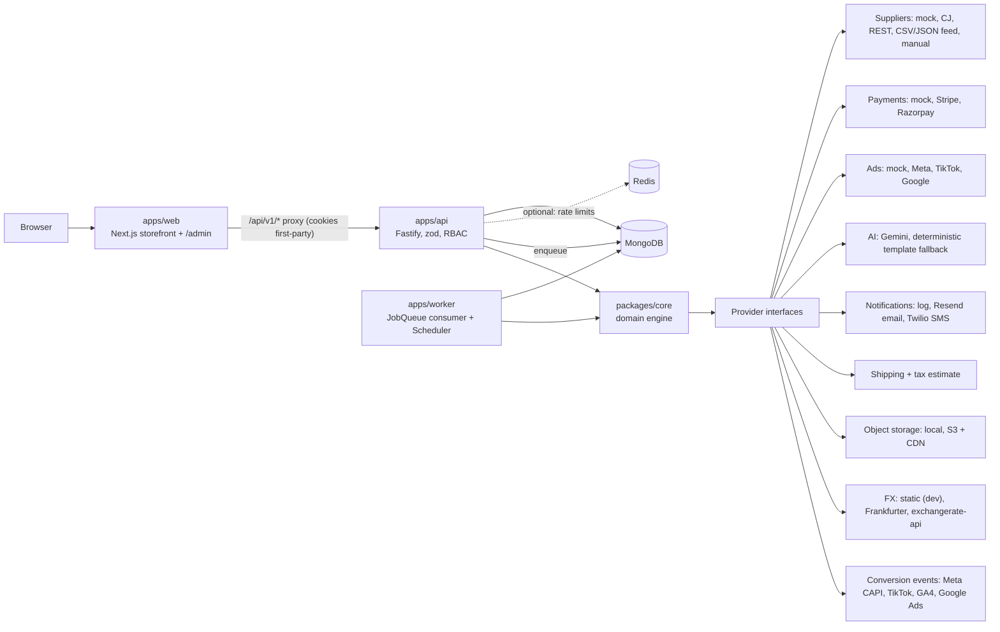
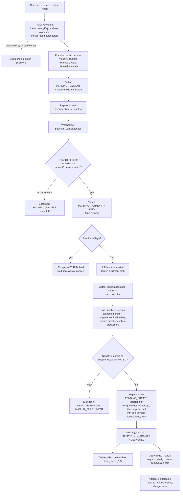
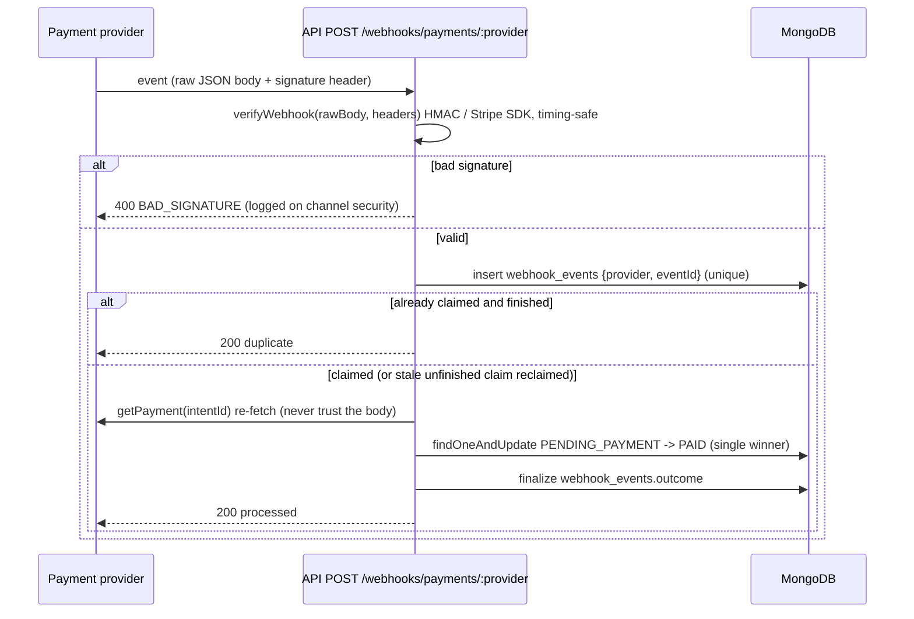
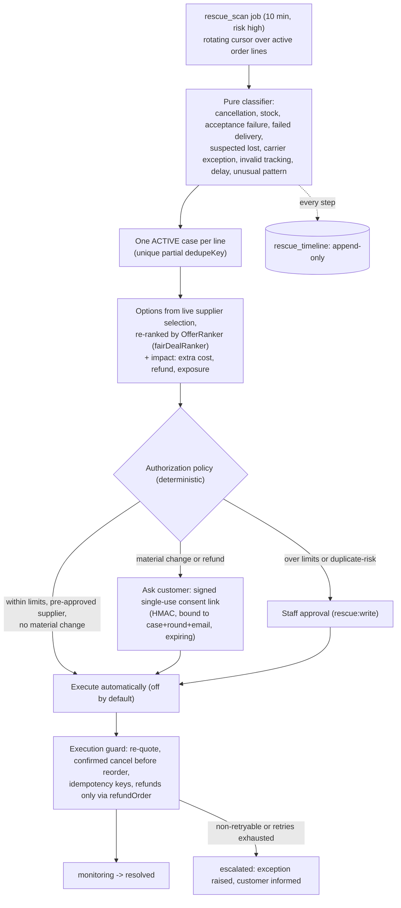
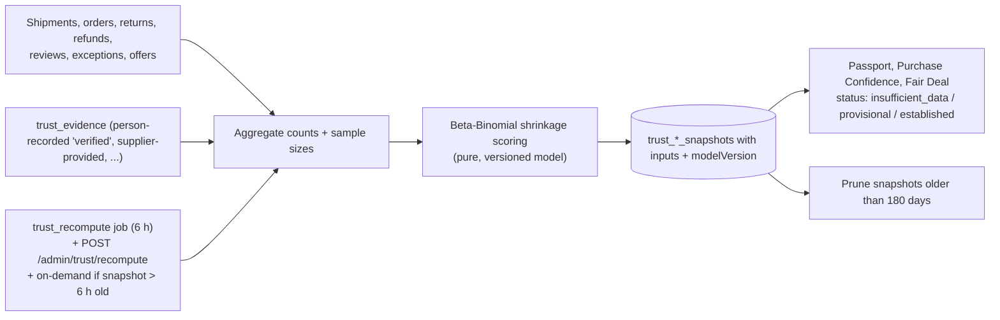
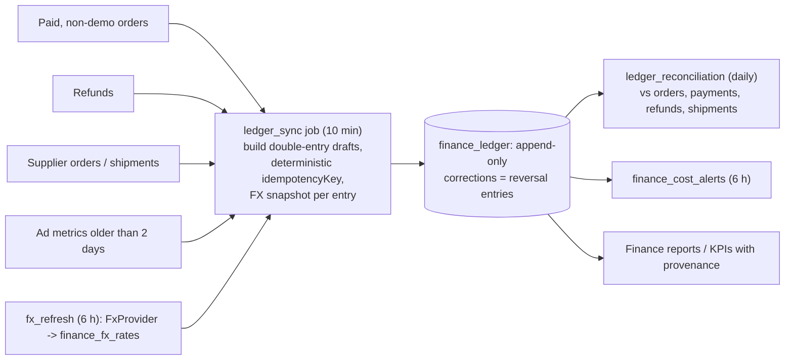
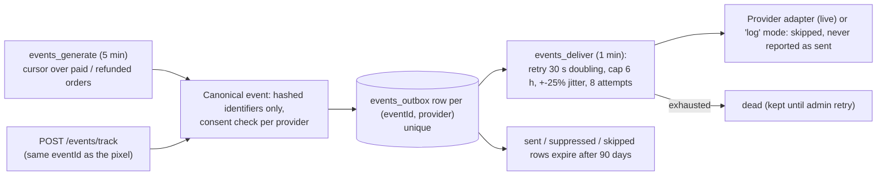
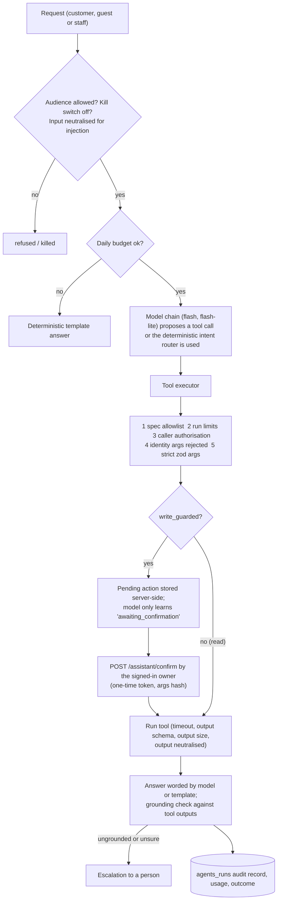

# ORVIA system architecture

How the system is put together, how data and decisions flow, and where it is meant to be extended. Written from the code on the `production` branch; every status label is explicit: **implemented** (code and unit tests exist), **requires credentials** (adapter written against public vendor documentation, never run against a live account), **partial**, or **planned** (no code). Older, shorter overview: [ARCHITECTURE.md](ARCHITECTURE.md). Database: [ORVIA_DATABASE_DESIGN.md](ORVIA_DATABASE_DESIGN.md). API: [ORVIA_API_REFERENCE.md](ORVIA_API_REFERENCE.md). Security: [ORVIA_SECURITY_AND_PRIVACY.md](ORVIA_SECURITY_AND_PRIVACY.md).

## 1. Components

| Component | Code | Role |
|---|---|---|
| Web | `apps/web` | Next.js App Router storefront and `/admin`. Depends only on `@orvia/types`, `@orvia/ui`, `@orvia/analytics` (no database or domain code). The browser talks to its own origin; `app/api/v1/[...path]/route.ts` proxies to the API so session cookies are first-party. Server components call the API with the visitor's cookie. |
| API | `apps/api` | Fastify. `registerPlugins` (helmet, CORS allow-list, cookies, global per-IP rate limit, OpenAPI, Mongo operator-key rejection, CSRF header check, error mapping) then 21 route modules. Every route is declared through `route()` (`src/http.ts`): zod body/query, auth mode, permission, optional rate limit. 440 routes, see the API reference. |
| Worker | `apps/worker` | Registers all job handlers (`registerJobs`), runs the Mongo-backed `JobQueue` consumer (`WORKER_CONCURRENCY`, 1 s poll) and the `Scheduler` (15 s tick when `SCHEDULER_ENABLED`). Exposes `/health` and `/metrics`. |
| Queue and scheduler | `packages/core/src/infra/queue.ts`, `jobs/index.ts` | Durable queue in the `jobs` collection: dedupe key (partial unique index), lock lease with crash reclaim, exponential backoff, dead-letter to an exception. The scheduler claims each time slot atomically in `system_settings`, so several workers fire a schedule once. Admin overrides of interval/enable live in `system_settings.schedule_overrides` (minimum 60 s). |
| Domain engine | `packages/core` | All business logic. Pure decision modules (scoring, state machines, refund maths, eligibility, rankers) are kept separate from IO so they run in DB-less unit tests. |
| Data | `packages/database` | Mongoose models (116), see the database document. |
| Shared | `packages/{types,config,auth,ui,analytics}` | zod schemas and enums; env config with a production guard; scrypt/JWT/AES-GCM and the RBAC matrix; design system; pure analytics/pricing/economics. |

Module boundaries enforced by package dependencies (checked in each `package.json`): `web` never imports `core` or `database`; `worker` has only `config`, `core`, `database`; provider packages (`suppliers, payments, ads, ai, notifications, shipping`) are imported by `core` and `api`, never the reverse; domain areas inside `core/src/domain/<area>/` expose a barrel (`index.ts`) with `register_<area>_Jobs(ctx)` and `<AREA>_SCHEDULES`, and import each other only through exported functions (for example rescue calls `refundOrder`, `selectSupplierLive`, `notify`; it does not touch the order schema directly).

### Providers

| Port | Implementations | Mode switch | Status |
|---|---|---|---|
| `SupplierProvider` (`packages/suppliers`) | mock, CJ Dropshipping, generic REST, CSV/JSON feed (SSRF-guarded fetch), manual | `SUPPLIER_MODE=mock|live`; per-supplier `fulfillmentMode` MANUAL / ASSISTED / AUTOMATED. AUTOMATED is refused until the validation suite passes | Mock and contract tests only. CJ/REST/feed: **requires credentials**, unverified against live APIs |
| `PaymentProvider` (`packages/payments`) | mock, Stripe, Razorpay | `PAYMENT_MODE` | Webhook signature verification unit-tested with vendor test helpers; live flow **requires credentials**, unverified |
| `AdProvider` (`packages/ads`) | mock, Meta, TikTok, Google | `ADS_MODE` | **requires credentials**; conversion-tracking verification pending (see ADS.md) |
| `AIProvider` (`packages/ai`) | Gemini; deterministic template fallback | `GEMINI_API_KEY` | Fallback implemented; live model **requires credentials**, never exercised against the API in tests |
| `NotificationProvider` (`packages/notifications`) | log (dev), Resend email, Twilio SMS | `NOTIFY_MODE=log|live` | Templates escaped and tested; live **requires credentials** |
| Shipping and tax (`packages/shipping`) | zone-rate shipping, tax/duty **estimate** (labelled as such) | none | Estimate only, not a tax engine |
| `ObjectStorage` (`core/infra/storage.ts`) | `LocalStorage`, `S3Storage` | `OBJECT_STORAGE_PROVIDER` (production requires `s3` + CDN) | S3 **requires credentials** |
| `FxProvider` (`core/domain/finance/fxProviders.ts`) | static (dev/test only), Frankfurter (ECB), exchangerate-api | `FX_PROVIDER` | HTTP adapters follow public docs, not run live |
| `MarketingEventProvider` (`core/domain/events/providers.ts`) | Meta CAPI, TikTok Events, GA4 Measurement Protocol, Google Ads conversions | `EVENTS_MODE`, `EVENTS_PROVIDERS` | **requires credentials**, unverified |

Production refuses to boot with mock or `log` modes, a weak `JWT_SECRET`, insecure cookies, `static` FX, private-network fetch allowed or a missing `ENCRYPTION_KEY` (`packages/config/src/index.ts`, `assertSafeForEnvironment`).

## 2. Data flows

### 2.1 Order lifecycle

Facts behind the diagram: `createOrderFromCart`, `settlePayment`, `fulfillOrder`, `syncTracking`, `refundOrder` in `packages/core/src/domain/orders.ts`. The legal export-attestation gate is never overridable by `force`. Supplier cost/ETA come from live quotes; tracking numbers only ever come from the supplier. Returns and refunds: `domain/aftersales/*` (state machines and refund maths are pure; refunds execute through the guarded `refundOrder`, which has approval limits). Order status values: `PENDING_PAYMENT, PAID, ..., DELIVERED, ON_HOLD, CANCELLED, REFUNDED, PARTIALLY_REFUNDED, REFUND_REQUESTED` (`ORDER_STATUSES` in `packages/types`).

### 2.2 Webhook handling and idempotency

Disputes and refund events take the same claim path (`aftersales/webhookClaim.ts`). A payment captured after the order was cancelled is recorded and handed to a human as a refund task (`latepay:<orderId>` exception) rather than swallowed. `webhook_events` expire after 90 days. The CSRF check skips `/api/v1/webhooks/` because those requests are signature-authenticated.

### 2.3 Delivery Rescue loop

AI plays no role in this loop; the optional `aiExplanation` field is empty because no model call is wired to it. Details: [ORVIA_DELIVERY_RESCUE.md](ORVIA_DELIVERY_RESCUE.md).

### 2.4 TrustGraph recompute

Below 5 resolved shipments the score is `null` and the UI says there is not enough history; nothing is invented. AI text is stripped of safety/compliance claims (`trust/guard.ts`). See [ORVIA_TRUSTGRAPH.md](ORVIA_TRUSTGRAPH.md).

### 2.5 Ledger sync

Keys look like `order_paid:<orderId>`, `refund:<refundId>`, `supplier_cost:<shipmentId>`, `ad_spend:<metricId>`; reposting is a no-op (unique key), and the schema rejects update/delete. If no live FX rate fresher than `FX_HARD_LIMIT_HOURS` exists, production refuses to price new orders from stale rates unless an admin override is set.

### 2.6 Event outbox (conversion tracking)

No consent means no forwarding (an explicit "no" wins). Raw email/phone are never stored in the outbox. Production refuses `EVENTS_MODE=log` when providers are enabled.

### 2.7 Agent run with tool gating

No tool calls a refund, payout, approval or permission function (a unit test greps the tool sources). Staff agents hold read-only tools. See [ORVIA_AI_AGENTS.md](ORVIA_AI_AGENTS.md).

## 3. Job inventory

41 entries in `DEFAULT_SCHEDULES` (`packages/core/src/jobs/index.ts`, merged with the per-workstream `*_SCHEDULES`). Intervals are the defaults; admins can override or disable each one (minimum 60 s). "Dial" is the automation key whose mode (`OFF | ASSISTED | AUTOMATIC`) gates the job's actions. Risk is the declared `risk` field. Production defaults for the dials are in `defaultAutomationModes` (`infra/settings.ts`): fulfilment, discovery and abandoned-cart are not automatic in production; publishing, pricing, ads and promotions are ASSISTED.

| Schedule | Job | Interval | Risk | Dial | Purpose |
|---|---|---|---|---|---|
| `order_sync` | `order_sync` | 5 min | high | order_fulfillment | Re-request fulfilment for paid orders that have none queued |
| `supplier_health` | `supplier_health` | 10 min | low |  | Probe supplier APIs; failing suppliers are excluded from new orders |
| `tracking_sync` | `sync_tracking` | 5 min | low | tracking | Poll suppliers for tracking and notify customers |
| `payment_verification` | `payment_verification` | 5 min | medium |  | Confirm stale unpaid orders with the payment provider |
| `inventory_sync` | `sync_inventory` | 5 min | medium | inventory_sync | Rotating supplier stock + price refresh; pause/restore products |
| `abandoned_cart` | `abandoned_cart` | 5 min | low | abandoned_cart | Consent-based cart recovery messages |
| `ad_metrics` | `sync_ad_metrics` | 15 min | low | ad_optimization | Pull ad platform metrics |
| `market_crawl` | `market_crawl` | 15 min | low |  | Crawl due public market sources (robots-aware, rate-limited, SSRF-guarded) |
| `market_index` | `market_index` | 1 h | low |  | Recompute trend scores and competitor prices from evidence |
| `product_performance` | `product_performance` | 1 h | low |  | Trend scores, review sentiment |
| `campaign_performance` | `optimize_ads` | 1 h | high | ad_optimization | Evaluate campaigns against budget rules |
| `pricing_analysis` | `pricing_analysis` | 1 h | high | dynamic_pricing | Pricing proposals within margin guardrails |
| `reconciliation` | `reconciliation` | 1 d | low |  | Orders / payments / refunds / supplier orders consistency |
| `housekeeping` | `housekeeping` | 1 h | low |  | Expire unpaid orders, refresh supplier reliability |
| `discovery` | `discovery` | 1 d | medium | product_discovery | Discover, score, import/propose products; start ad tests |
| `product_scoring` | `score_products` | 1 d | low |  | Recompute opportunity scores |
| `daily_brief` | `daily_brief` | 1 d | low | ai_reports | Daily business brief |
| `trust_recompute` | `trust_recompute` | 6 h | low |  | TrustGraph supplier/product snapshots |
| `rescue_scan` | `rescue_scan` | 10 min | high |  | Delivery Rescue detection, planning, due actions |
| `customer360_sweep` | `customer360_sweep` | 6 h | low |  | Delete expired memory; mark deletion requests past cooling-off |
| `find_price_snapshot` | `find_price_snapshot` | 1 d | low |  | Price Guard price snapshots (changes only) |
| `find_price_alerts` | `find_price_alerts` | 1 h | low |  | Evaluate price/stock alerts, notify verified owners |
| `find_saved_search_alerts` | `find_saved_search_alerts` | 1 d | low |  | Saved-search new-match alerts (opt-in) |
| `fx_refresh` | `fx_refresh` | 6 h | low |  | Refresh stored FX rates |
| `ledger_sync` | `ledger_sync` | 10 min | low |  | Post paid/refunded orders, supplier costs, ad spend |
| `ledger_reconciliation` | `ledger_reconciliation` | 1 d | low |  | Ledger vs orders, payments, refunds, shipments |
| `finance_cost_alerts` | `finance_cost_alerts` | 6 h | low |  | Supplier cost above the cost the price was based on |
| `creator_ledger_settle` | `creator_ledger_settle` | 1 h | medium |  | Claw back refunded commissions, release held ones |
| `creator_ledger_deep_scan` | `creator_ledger_settle` | 1 d | low |  | Wide refund/clawback sweep |
| `loyalty_expire` | `loyalty_expire` | 1 d | low |  | Expire points, restore unused redemption codes |
| `events_generate` | `events_generate` | 5 min | low |  | Conversion events from orders (cursor + idempotency) |
| `events_deliver` | `events_deliver` | 1 min | low |  | Outbox delivery with retry/dead-letter |
| `events_campaign_dispatch` | `events_campaign_dispatch` | 5 min | medium |  | Start due email campaigns (consent-filtered) |
| `suppliernet_sla` | `suppliernet_sla` | 6 h | medium |  | Supplier SLA facts, breaches, demotion on critical breach |
| `suppliernet_verification_sweep` | `suppliernet_verification_sweep` | 1 d | low |  | Lapse expired verification and documents |
| `suppliernet_feed_refresh` | `suppliernet_feed_refresh` | 6 h | low |  | Re-ingest CSV/JSON feed suppliers (read-only) |
| `aftersales_chargeback_deadlines` | `aftersales_chargeback_deadlines` | 1 h | low |  | Escalate chargebacks near their evidence deadline |
| `aftersales_provider_reconciliation` | `aftersales_provider_reconciliation` | 6 h | medium |  | Compare recent payments with the provider (read-only) |
| `aftersales_refund_sync` | `aftersales_refund_sync` | 15 min | low |  | Complete returns whose refund was approved/finished |
| `agents_maintenance` | `agents_maintenance` | 1 d | low |  | Expire stale confirmations, delete conversations past retention |
| `promotion_analysis` | `recommend_promotions` | 1 d | medium | promotion_optimization | Recommend country promotions |

On-demand jobs (enqueued, not scheduled): `send_notification`, `fulfill_order`, `image_ingestion`, `referral_settle`, `review_request`, `rescue_run_action`, `creator_commission_accrue`, `loyalty_earn` (and other area handlers registered by their `register_<area>_Jobs`). The table was produced by printing `DEFAULT_SCHEDULES` (41 entries); keep it in sync when schedules change.

## 4. Extension points

| Seam | Interface | Default | How to extend |
|---|---|---|---|
| Suppliers | `SupplierProvider`, `SupplierRegistry.registerFactory`, capabilities declaration | mock; `manual` factory | Implement the interface, declare capabilities truthfully, add a fake-server test, run the validation suite in staging |
| Payments / ads / notifications / AI | provider interfaces in their packages | mock / log / template | Same pattern; production guard rejects non-live modes |
| `OfferRanker` (`rescue/ranker.ts`) | `rank(offers, input)` | `fairDealRanker` is installed by `register_rescue_Jobs`; `LocalOfferRanker` (`local-v1`) is the fallback | `setOfferRanker()` with any deterministic ranker |
| `SemanticIndex` (`find/semantic.ts`) | `build(docs)`, `query(text)` | `TfIdfSemanticIndex` (classical TF-IDF cosine, labelled as not neural); `NoopSemanticIndex` | Provide an embedding-backed index; the API reports `engine.semantic` so the UI cannot overstate it |
| `FxProvider` (`finance/fxProviders.ts`) | `fetchRates(now)` | Frankfurter in production | `setFxProvider(ctx, p)` |
| `MarketingEventProvider` (`events/providers.ts`) | `isConfigured, supports, send...` | per `EVENTS_PROVIDERS` | Add an adapter and register its key in `MARKETING_PROVIDER_KEYS` |
| Agent specs (`agents/specs.ts`) | spec: id, audience, tool allowlist, budgets, model chain | 11 agents | Add a spec and tools (`tools.customer.ts` / `tools.staff.ts`); read tools only for staff; write tools must be `write_guarded` |
| Automation dials | `ctx.settings.automationMode(key)` + `proposeOrExecute` | per `defaultAutomationModes` | Add a key to `AUTOMATION_KEYS` and a schedule with `automation` |
| Jobs | `register_<area>_Jobs(ctx)` and `<AREA>_SCHEDULES` | | Add handler and schedule in the area barrel; `registerJobs` merges them |
| Object storage | `ObjectStorage` | local / S3 | Implement `get/put/publicUrl` |

## 5. Deterministic vs AI-decided responsibilities

| Decision | Who decides | Notes |
|---|---|---|
| Prices, tax estimate, shipping, discounts, totals | Deterministic (`priceCart`, shipping/tax package) | Browser never sends a price |
| Payment status, order transitions | Deterministic, provider re-fetch + atomic update | Webhook body is not trusted |
| Refund eligibility, amount and approval limit | Deterministic (`aftersales/eligibility`, `refundMath`, `refundOrder`) | Agents explain, never grant |
| Supplier selection and routing | Deterministic ranking by expected profit and experience, with gates | Verified-supplier gate in production |
| Delivery Rescue classification, options, authorization | Deterministic | AI slot is empty |
| Trust scores, risk, Fair Deal | Deterministic, versioned, with sample-size honesty | AI text is claim-stripped |
| Ledger posting, FX, reconciliation | Deterministic | Append-only |
| Fraud score, hold | Deterministic rule score | |
| Permissions and ownership | Deterministic (RBAC matrix, query predicates) | An LLM never changes permissions |
| Creator commissions, loyalty points, payouts | Deterministic; payouts need staff approval and are paid manually | |
| Product description wording, ad copy, daily brief wording | AI-suggested (Gemini or template fallback), schema-validated and grounded; claims stripped | Labelled `ai_suggested` |
| Natural-language search intent | Deterministic parser first; optional AI refinement | |
| Assistant answer wording and read-tool choice | AI optional (needs key); deterministic router otherwise | Writes only after the owner's confirmation |
| Dynamic pricing, product publishing, ad budget changes | Rule engines propose; the automation dial (ASSISTED by default) decides whether a human approves | |

## 6. Future architecture (status labels)

Nothing in this section is claimed as shipped unless labelled implemented.

| Capability | Status | Evidence / what is missing |
|---|---|---|
| Governed conversational assistant (text) | **Partial** | Deterministic intents, guarded actions, conversations and grounding are implemented; model-worded answers need `GEMINI_API_KEY` and were never run against the live API. No streaming. |
| Visual (image) search | **Partial, requires credentials** | `POST /find/image` + `describeImage` in the Gemini provider exist; returns `503 not_configured` without a vision provider. No image-embedding index. |
| Semantic search | **Partial** | TF-IDF lexical similarity only. Neural embeddings: **planned** (`SemanticIndex` seam exists). |
| Voice assistant | **Planned** | No code. |
| Predictive stock / demand forecasting | **Planned** | Inventory is supplier-reported stock polled by `inventory_sync`; no forecasting model. Finance has scenario analysis, not stock prediction. |
| Dynamic pricing | **Partial** | `pricing_analysis` proposes changes within margin guardrails; default mode ASSISTED (human approves). Not demand-elastic ML. |
| Automatic supplier ordering for live suppliers | **Partial, requires credentials** | AUTOMATED mode is gated by a validation suite; adapters unverified against live accounts. |
| AI-written rescue explanations | **Planned** | Field exists, no model call wired. |
| Real LLM token accounting | **Planned** | Budgets use an estimate (provider returns no usage). |
| Server-side ad conversion tracking | **Implemented, unverified** | Adapters written to public docs; need live accounts to verify. |
| Live FX rates | **Implemented, unverified** | HTTP adapters not run live. |
| Redis-backed shared cache / rate limits | **Partial** | Redis is optional for rate limits; search index and catalog caches are per-process memory. |
| Search at scale (Atlas Search / external engine) | **Planned** | In-process index capped at 5000 documents. |
| Multi-region / multi-currency beyond US, CA, IN | **Planned** | Countries are an enum (`US, CA, IN`). |
| Tamper-proof audit trail (WORM / separate DB role) | **Planned** | Audit log is insert-only by convention. |
| Per-market legal compliance automation | **Planned** | Guard rails exist (export attestation, product compliance filter); no legal sign-off, see the obligations checklist in the security document. |
